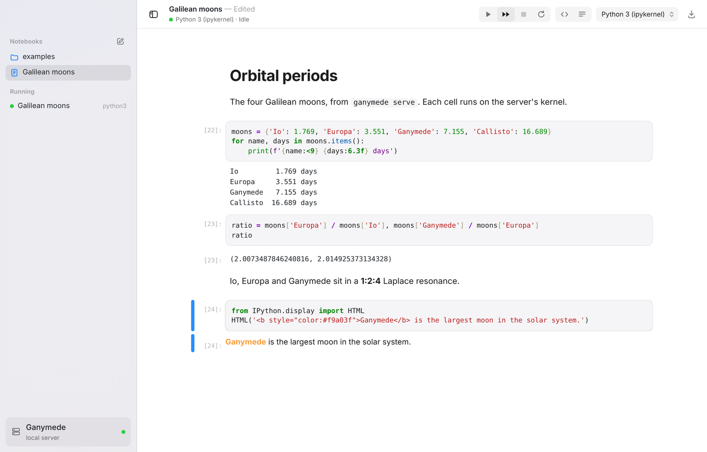
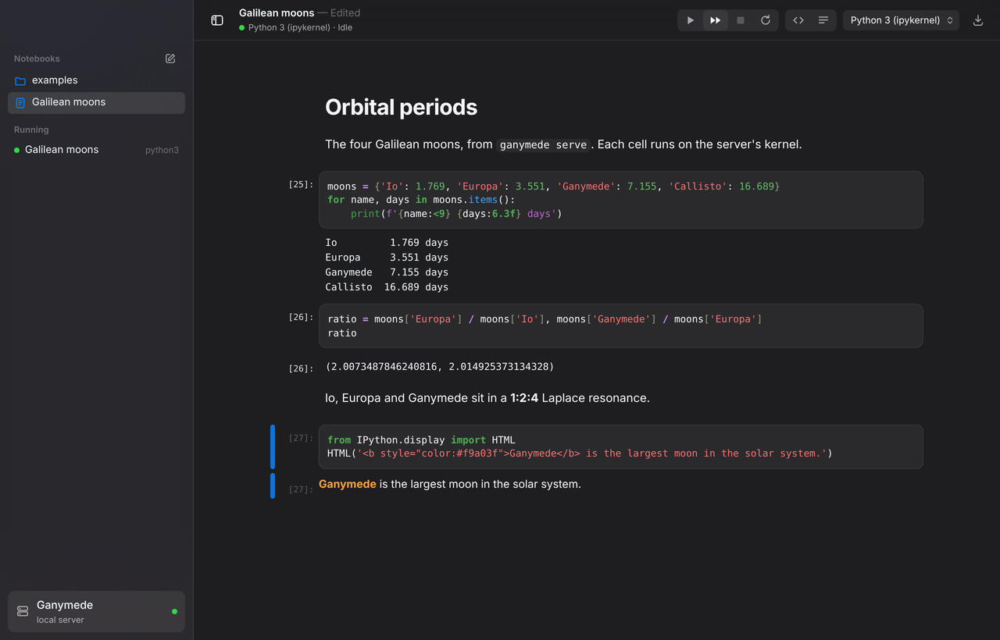
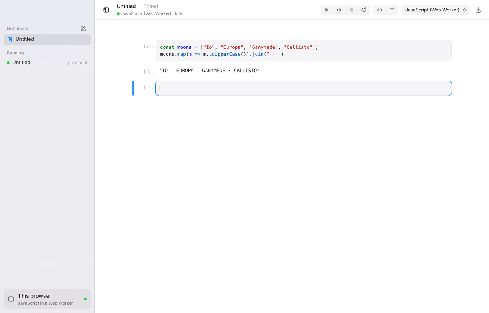

# ganymede-ui

A standalone notebook app for [Ganymede](https://github.com/tlockney/ganymede),
built on [datalayer/jupyter-ui](https://github.com/datalayer/jupyter-ui)
(`@datalayer/jupyter-react`) with Vite, styled to look like a macOS app, and
installable as a PWA. Kernels run either on a Ganymede server or in the
browser.

**Status:** working prototype. Runs notebooks against `ganymede serve` and
against an in-browser JavaScript kernel in a Web Worker. Candidate for its own
repo (`ganymede-ui`).



| Dark | In-browser kernel |
|---|---|
|  |  |

## Run

```sh
ganymede serve --port 8888 --token test     # in a folder of notebooks
npm install
npm run dev                                 # http://localhost:5173/?token=test
```

The dev server proxies `/api` to `GANYMEDE_URL` (default
`http://127.0.0.1:8888`), so the page and the server share an origin. A token
in the page URL connects at once; otherwise a sheet asks where kernels run.
To test the in-browser kernel and the service worker, use the production
build: `npm run build && npm run preview` (same proxy, port 4173). To point a
deployed copy at a server on another origin, start Ganymede with
`--allow-origin <app origin>` and enter its URL in the sheet.

`node scripts/screenshots.mjs <url> <token> <dir> [light|dark]` drives the
built app with Playwright against a server that has `Galilean moons.ipynb`.
`node scripts/render-icons.mjs` regenerates the PNG icons from
`public/icons/icon.svg`. Both need the `playwright` package.

## How it fits together

- **Backends** (`src/lib/backends.ts`). The UI only uses a
  `ServiceManager.IManager`. `ganymede` builds one over REST and websocket;
  `browser` builds JupyterLite's in-page server with jupyter-react's
  JavaScript Web Worker kernel, storing notebooks in IndexedDB. This is the
  answer to the browser-kernel thread's UI question: a Worker cdp-kernel
  becomes one more JupyterLite kernel plugin, and the app needs no change.
- **Notebook** (`src/components/NotebookPane.tsx`). jupyter-react's
  `Notebook` in nbformat mode. The pane starts or rejoins the file's kernel,
  tracks status, and loads and saves through the contents API.
- **Shell** (`src/components/`, `src/styles/app.css`). Unified toolbar,
  translucent source-list sidebar, sheets, segmented controls, system fonts
  and accent, light and dark from the system setting.
  `src/styles/jupyter.css` restyles JupyterLab through its CSS variables.
- **PWA** (`vite.config.ts`). Workbox precache, manifest with
  `window-controls-overlay`, Apple touch icon. `/api/` is never cached.

## Findings

- jupyter-ui works as a library outside JupyterLab, but its Vite setup leans
  on a require.js script from a CDN and a hosted Datalayer server URL as the
  default. Both are replaced here; see [notes.md](notes.md).
- Ganymede needed no changes. `@jupyterlab/services` works against it as is,
  through a proxy that rewrites `Origin`, or cross-origin with
  `--allow-origin`.
- Restyling via JupyterLab's CSS variables gets most of the native look;
  fighting Lumino's layout does not (the notebook must scroll itself).
- jupyter-react is heavy: 3.5 MB main chunk, 8.3 MB precached, because it
  pulls in Pyodide, Plotly and Primer whether used or not.

Known gaps are listed at the end of [notes.md](notes.md).

## Next

1. Wire in the Worker cdp-kernel from the browser-kernel thread as a
   JupyterLite kernel plugin, next to the JavaScript one.
2. Decide on jupyter-react versus `@jupyterlab/notebook` directly; the latter
   would drop Primer, Pyodide and Plotly and most of the bundle.
3. Fix the in-browser kernel under `npm run dev` (exclude the Worker from
   pre-bundling) and serve JupyterLite's service worker without clashing
   with Workbox.
4. File operations (rename, delete, upload), a command palette, menus.
5. Serve the built app from Ganymede itself (`--static-dir`-style), so an
   installed PWA and the server share an origin.
